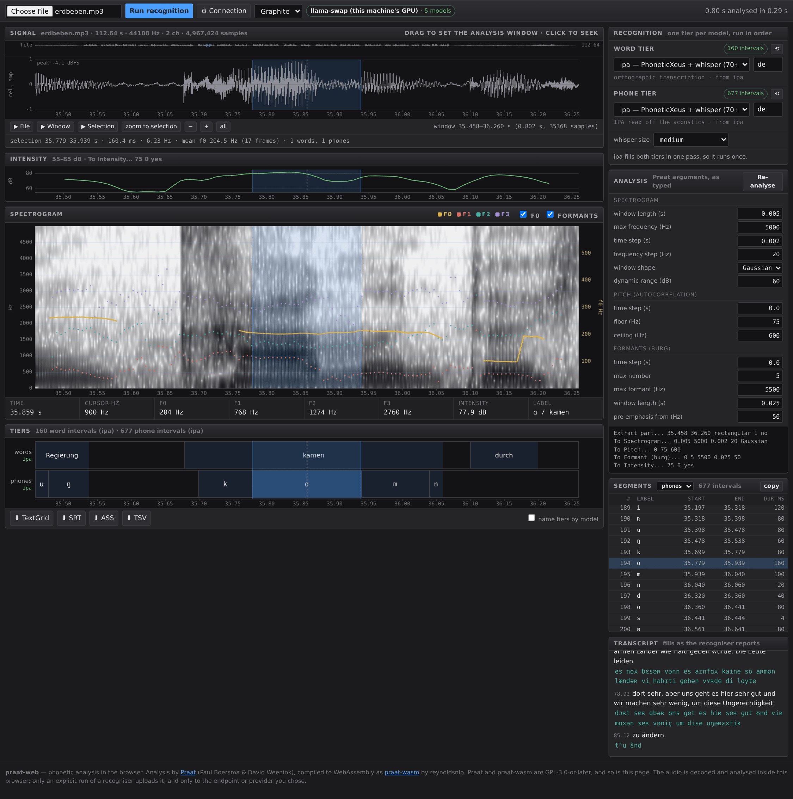
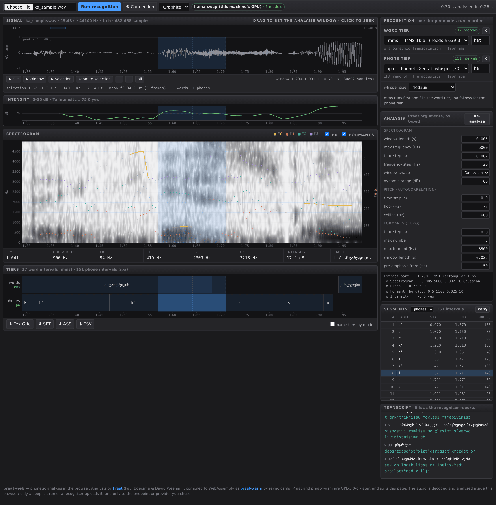
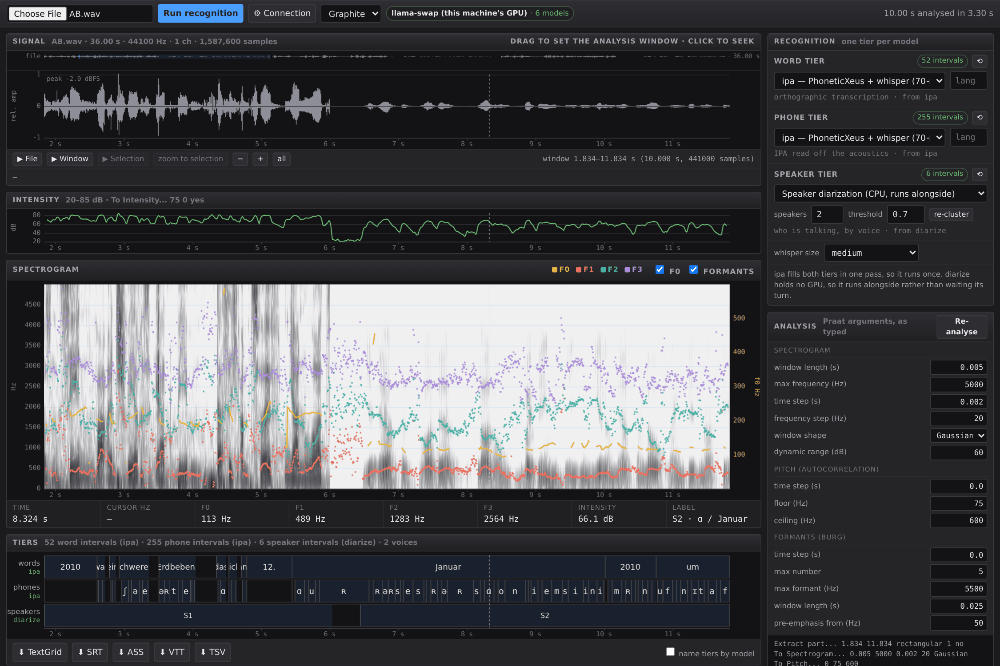
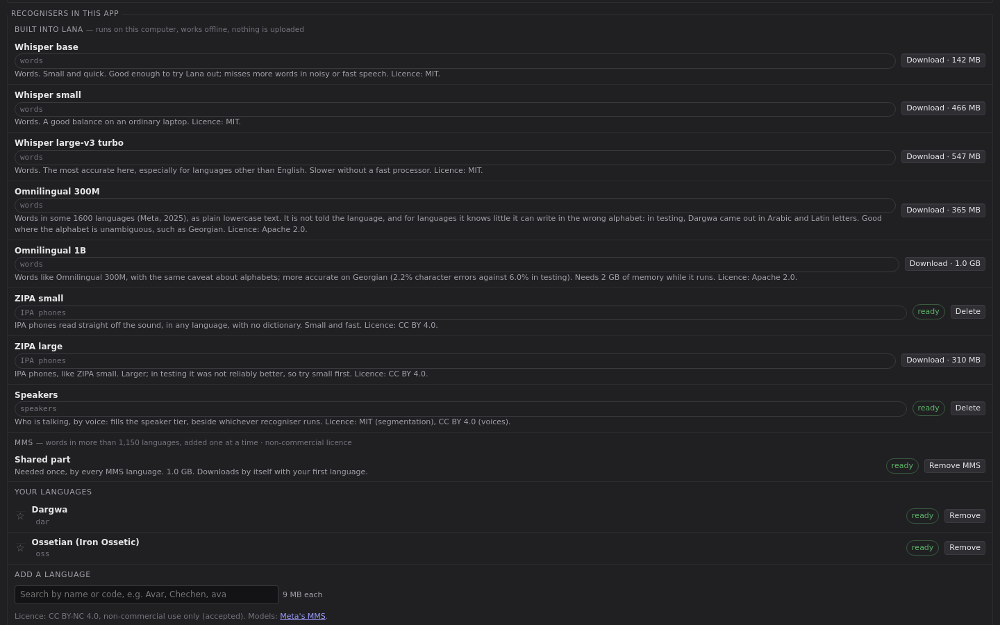
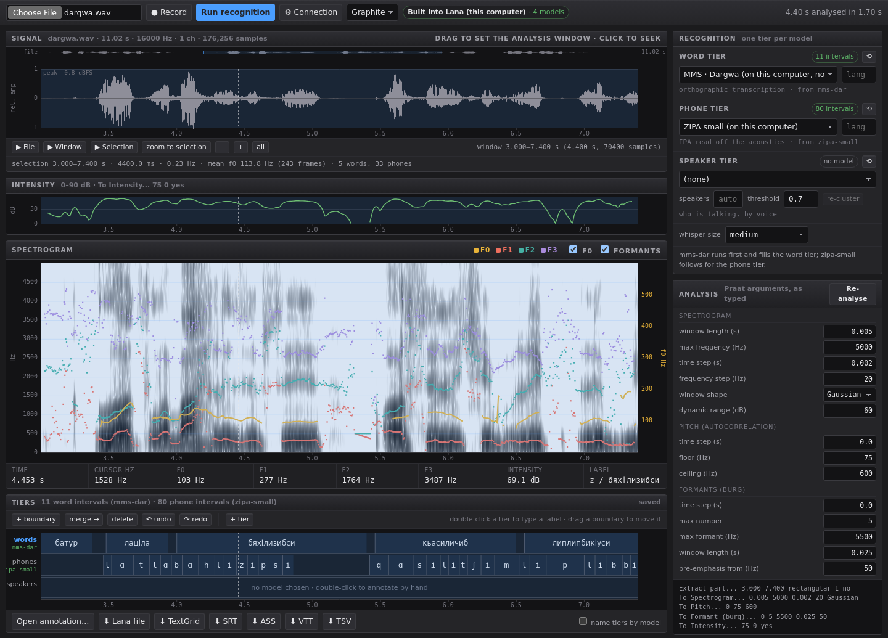
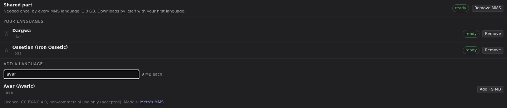

# Lana

**L**inguistic **ANA**lysis: Praat's acoustic analysis with word, phone and speaker tiers filled by speech recognition, exported as a TextGrid. Lana runs in a browser or as a desktop app for macOS (Apple Silicon), Windows 11 and Linux. It is built on [Praat](https://www.fon.hum.uva.nl/praat/) (Paul Boersma and David Weenink) but is not part of the Praat project or endorsed by its authors.



Most tools that time annotation to a recording begin from orthography. A forced aligner looks each word up in a pronunciation dictionary and fits the expected phones to the signal, so the labels describe what the lexicon predicts rather than what the speaker produced. Lana takes its phone tier from recognisers that read IPA off the acoustics, with no dictionary in the path, and its word tier from a separate model. The two tiers are therefore independent observations of the same signal, and where they diverge the divergence is itself the data. The same design is what makes the tool usable for languages that have no pronunciation dictionary at all, which is to say most of the languages documentation work is concerned with.



Georgian shows why the two tiers are kept apart. The word tier is MMS with its Georgian adapter and the phone tier is a separate phone recogniser, which gives the word ანტარქტიკის as ɑ n tʼ ɑ r kʼ tʼ i kʼ i s, with ejectives where the orthography has ტ and ქ. Neither model consulted the other's output, so the phones record what the frames supported, whatever the word tier says.

Everything a phonetician would otherwise have to trust is on screen. Pitch, formants, intensity and the spectrogram are computed by Praat itself, compiled to WebAssembly, and every argument that shaped them is an editable field beneath which the page prints the literal Praat commands. Machine labels are a first pass to be checked against the spectrogram, not a measurement, and the interface is built to make that checking cheap. The reasoning behind these choices, and what CTC phone timings can and cannot support, is set out in [`web/README.md`](web/README.md).

## Two ways to run it

**In a browser.** `web/` is a static page and a standard-library Python server. Run `python3 web/serve.py` and open `http://127.0.0.1:8710`. The audio is analysed in the browser and never leaves it unless you send it to a recogniser you have configured. The browser version brings no recognition of its own: it connects to a service you run, such as a local GPU server, or to a provider such as OpenAI. Adding `?demo` to the address replays recorded results for two readings of a FLEURS sentence, in Georgian and German, over live Praat analysis.

**As a desktop app.** The same interface in a native window, with recognition built in. Models are downloaded from the settings screen and run on the computer's own processor, offline, so a researcher with no server and no command-line experience can go from an audio file to a TextGrid with IPA in it. API keys for online providers are kept in the operating system's keychain rather than in a file.

The language of a recording is chosen by name, from some 1,200 languages, and each model is sent the code it understands: Whisper's own token, ISO 639-1 for OpenAI-shaped services, ISO 639-3 for MMS and OWSM, and nothing for the models that need no language. A linguist therefore never has to know which standard a given recogniser follows, and the interface says so when a chosen model does not know the language at all, as Whisper does not know Dargwa, rather than letting it guess silently. Runs on the open recording go into a queue, so a second model can be tried while the first is still reading, and every model, the built-in ones included, fills its tier piece by piece while it runs.

Both versions support hand annotation and TextGrid import, so a machine tier can be corrected in place and an existing annotation, from Praat or exported from ELAN, can be opened beside the recording. Both record directly from a microphone. Both also save the annotation as it changes, under a key derived from the content of the audio rather than its file name, so a renamed or moved recording still opens with its tiers. The desktop app keeps these saves as files in its data folder, while the browser keeps them in its own storage, which means they do not travel between browsers or machines.

Any number of further tiers can be added beside the machine-filled ones. A new tier starts empty, for notes, glosses or comments, or as a copy of a tier already on screen, either with its labels or with its boundaries alone, so that the same stretches can be glossed or tagged. A tier can also start as ARPABET, the ASCII phone set of CMUdict, the Montreal Forced Aligner's English models and much American-English phonetics. It is converted from the IPA phone tier in either CMU's 39 phones or TIMIT's larger set, which adds the flap, the glottal stop, reduced vowels and syllabic consonants. Stress marks in the IPA become digits on the following vowel, and no digits are written when the phones carry no stress marks, because a recogniser that never marks stress would otherwise make every vowel look unstressed. The conversion is phonemic, and it does not guess where the IPA has no ARPABET counterpart. In CMU's set a flap could be T or D, so it is kept as it is and marked in orange, and a menu item steps through the marked labels. An ARPABET tier accepts either ARPABET or IPA as it is typed and stores ARPABET, so one marked label can be corrected without looking up the code. Any tier can be given its own colour from its right-click menu. Each colour has a shade for the dark theme and one for the light Paper theme, so a figure exported in Paper keeps the tiers apart as the screen did.



A third tier records who is speaking. Speaker diarisation keys on the voice rather than on the words, so it needs no language code and runs beside the recogniser rather than after it. Here two German speakers were spliced into alternating six-second blocks, so the correct answer is known in advance: the tier closes S1 at 6.04 s and opens S2 at 6.44 s, and leaves the silence between them unattributed.

## Installing

Installers are published on the [Releases](https://github.com/3-mmc/lana/releases) page. Lana is not yet signed with an Apple or Microsoft certificate, so both systems warn before its first launch; the warning concerns who published the app rather than anything it does, and it appears only once.

- **macOS (Apple Silicon).** Open the `.dmg` and drag Lana into Applications. On first launch macOS reports that it cannot verify the app. Click **Done**, open System Settings → Privacy & Security, and click **Open Anyway** beside the message about Lana. Intel Macs are not supported.
- **Windows 11.** Windows 10 should work but has not been tested. Run the `-setup.exe`. If SmartScreen reports that it protected your PC, click **More info**, then **Run anyway**.
- **Debian and Ubuntu.** `sudo apt install ./Lana_<version>_amd64.deb`
- **Arch Linux.** Use the `.AppImage`, which carries its own WebKitGTK and leaves the system's libraries alone. It mounts itself through FUSE and needs the `fusermount3` helper from `fuse3`, which most Arch desktops already have but a minimal install may not:

  ```sh
  sudo pacman -S --needed fuse3
  chmod +x Lana_<version>_amd64.AppImage
  ./Lana_<version>_amd64.AppImage
  ```

  Without `fuse3`, the file stops with "No suitable fusermount binary found". The `.deb` is built against Debian's library versions and should not be converted for Arch. To build from source instead, see [Building on Arch](#building-on-arch).
- **Other Linux distributions.** The `.AppImage` as above, installing your distribution's `fuse3` package if `fusermount3` is missing.

Between releases, a manual run of the [build workflow](https://github.com/3-mmc/lana/actions/workflows/build.yml) produces installers as downloadable artefacts, which requires a GitHub account.

## Built-in recognition

The built-in models keep recordings on the computer. They run on its own processor, work offline once downloaded, and send no audio, transcription or annotation anywhere, which is usually what an ethics board or a data-management plan needs to know about recordings of identifiable speakers. The app makes exactly two kinds of connection of its own. It downloads a model from Hugging Face when one is chosen, and it asks GitHub whether a newer release exists, a few seconds after it starts. Neither request carries anything about the recordings. Audio leaves the machine only when a cloud service or a speech server has been added and then run, and every place a recogniser is chosen says where its audio goes.

The desktop app's catalogue covers each tier with at least one model that runs on an ordinary laptop. Each entry states its size and licence before anything is downloaded, and the downloaded files are checked against the checksums HuggingFace publishes for them.

| Model | Tier | Download | Licence |
| --- | --- | --- | --- |
| Whisper base, small, large-v3 turbo | words | 142–547 MB | MIT |
| Omnilingual ASR 300M, 1B (Meta) | words | 365 MB, 1 GB | Apache 2.0 |
| MMS-1b-all (Meta), per language | words | 1 GB once, then about 9 MB a language | CC BY-NC 4.0 |
| ZIPA small, large | IPA phones | 71 MB, 310 MB | CC BY 4.0 |
| Speakers (pyannote segmentation + speaker embedding) | speakers | 36 MB | MIT, CC BY 4.0 |



The catalogue as the settings screen presents it, grouped by the tier each model fills. Each model says what it is good for, in the terms a user choosing between them needs, rather than in benchmark names.

The choice of word model depends on the language more than on the size of the model. Omnilingual covers some 1,600 languages, but it is not told which language it is hearing, and where the writing system is ambiguous it guesses. On 40 held-out Common Voice recordings each, it wrote Dargwa in Arabic or Latin letters rather than Cyrillic:

| Character error rate | Dargwa | Ossetian |
| --- | --- | --- |
| MMS, with the language's adapter | **10.1%** | **12.1%** |
| Omnilingual 300M | 68.1% | 38.7% |
| Omnilingual 1B | 85.3% | 38.6% |

MMS avoids the problem because it loads a separate adapter for each of its languages, more than 1,150 of them, so the language, and with it the alphabet, is fixed before recognition begins. Lana downloads the shared part of the model once and each adapter on request; the adapter files come from Meta's own repository and are fitted to the shared part on the user's computer. The MMS figures above are from Lana's converted model, against 10.0% and 11.7% for Meta's original. Georgian shows the other side of the comparison: its script is unambiguous, so Omnilingual 1B made 2.2% character errors on the demo recording, while MMS made 0.7%.



A Dargwa sentence from Common Voice, analysed entirely on a laptop processor with no network connection after the models were downloaded. MMS with the `dar` adapter filled the word tier and ZIPA small the phone tier, both in under six seconds for eleven seconds of audio. The cursor sits at 4.45 s on the [z] of *бяхӀлизибси*, and the readout gives f0 103 Hz, F1 277 Hz and F2 1764 Hz at that instant. The segment table on the right lists every word with its start, end and duration in milliseconds.

MMS is licensed for non-commercial use only. The settings screen therefore explains the licence and asks the user to accept it before anything is downloaded, and every MMS entry in the model menus is labelled as non-commercial. The converted shared files are published at [3mmc/lana-mms-1b-all-onnx](https://huggingface.co/3mmc/lana-mms-1b-all-onnx) under the same licence, with the conversion scripts in [`scripts/mms`](scripts/mms).

Languages a researcher returns to can be pinned, which moves them to the top of the language list and of the word tier's menu. The app ships no preset list of languages, because the languages that matter are the user's, not the developer's.



Recognition services remain available alongside the built-in models, for recordings that need a larger model than a laptop can run. The settings screen offers OpenAI, Groq and Cloudflare Workers AI as presets. Cloudflare's free daily allowance covers about three and a half hours of audio with Whisper large-v3 turbo, which makes it the cheapest route to a large Whisper model; like every Whisper, it does well on German and poorly on Georgian. Any other service that implements OpenAI's `/v1/audio/transcriptions` can be added from the same screen, or listed in `providers.json` in the app's configuration folder, in the same format `web/serve.py` reads. Recordings sent to a cloud provider are uploaded to it, and the settings screen says so when one is added. The tier contract that a service must meet to fill the word and phone tiers is documented in [`web/README.md`](web/README.md#the-tier-contract).

## Building from source

Prerequisites: [Rust](https://rustup.rs), the Tauri CLI (`cargo install tauri-cli --locked`), the [Tauri system dependencies](https://v2.tauri.app/start/prerequisites/) for your platform, and, for the built-in Whisper models (whisper.cpp), **cmake** and **libclang**:

- **macOS:** `xcode-select --install` provides libclang. Install cmake from [cmake.org](https://cmake.org/download/) or with `brew install cmake`.
- **Linux (Debian/Ubuntu):** `sudo apt install cmake libclang-dev`
- **Windows:** Visual Studio Build Tools ships cmake (add its `CMake\bin` to `PATH`). For libclang, set `LIBCLANG_PATH` to a folder containing `libclang.dll`, from an LLVM install or the `libclang` wheel on PyPI. Do not set `WHISPER_DONT_GENERATE_BINDINGS`: the bundled bindings are generated on Linux, and their struct layouts do not compile on Windows.

```sh
git clone https://github.com/3-mmc/lana
cd lana
scripts/fetch-praat-wasm.sh              # 24 MB, once, into vendor/
cd src-tauri
cargo run                                # development
cargo run -- path/to/recording.wav       # open a recording at start
cargo tauri build                        # installer for this platform
```

The desktop app serves `web/index.html` unchanged from an embedded local server and reimplements `serve.py`'s `/api/*` routes in Rust, so the browser and desktop versions share one interface rather than maintaining two. Features that only the desktop can offer, such as model downloads and the keychain, are switched on by the page after it asks the server what it supports, which leaves the browser version unaffected. `scripts/parity-test.py` sends identical requests to `web/serve.py` and to the Rust server through a mock recogniser, and fails on any difference that is not listed as deliberate. The design and its milestones are in [PLAN.md](PLAN.md).

### Building on Arch

The Tauri dependencies, cmake and clang come from the official repositories; `rustup` provides the toolchain.

```sh
sudo pacman -S --needed webkit2gtk-4.1 base-devel curl wget file openssl \
    appmenu-gtk-module libappindicator-gtk3 librsvg xdotool cmake clang rustup
rustup default stable
git clone https://github.com/3-mmc/lana && cd lana
scripts/fetch-praat-wasm.sh
cd src-tauri && cargo build --release      # or: cargo tauri build --bundles appimage
```

On a clean Arch system this builds in about three and a half minutes on eight cores. `scripts/fetch-praat-wasm.sh` must run first, because the build embeds praat-wasm and stops with ``resource path `../vendor` doesn't exist`` without it.

Without an Apple Developer ID, macOS builds are ad-hoc signed. A copy built on the Mac itself opens normally; a downloaded copy has to be allowed once under System Settings → Privacy & Security → **Open Anyway**.

## Credits and licence

Lana is made by [Aaron van Blerkom](https://www.linkedin.com/in/aaron-van-blerkom).

The analysis is Praat by Paul Boersma and David Weenink, through [praat-wasm](https://www.npmjs.com/package/praat-wasm) by reynoldsnlp. If Praat contributed to published work, cite it as its authors ask:

> Boersma, Paul & Weenink, David. *Praat: doing phonetics by computer* [Computer program]. http://www.praat.org/

The built-in models are the work of their authors: Whisper (OpenAI), MMS and Omnilingual ASR (Meta), ZIPA (Zhu et al. 2025), and pyannote's segmentation model, run through [whisper.cpp](https://github.com/ggml-org/whisper.cpp) and [sherpa-onnx](https://github.com/k2-fsa/sherpa-onnx). MMS is described in Pratap et al. (2023), *Scaling Speech Technology to 1,000+ Languages*.

Lana is GPL-3.0-or-later, as praat-wasm requires. Until October 2026 the browser interface was a separate repository, `3-mmc/lana-web`, formerly `praat-web`; its history is preserved in `web/`.
