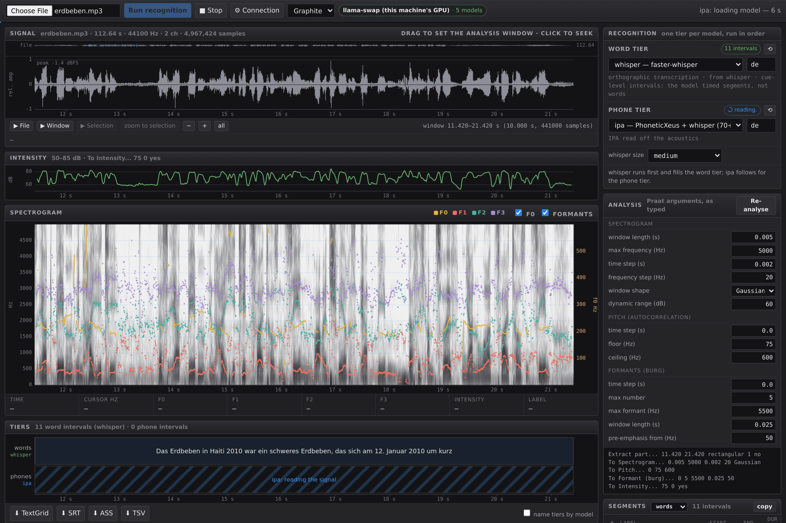
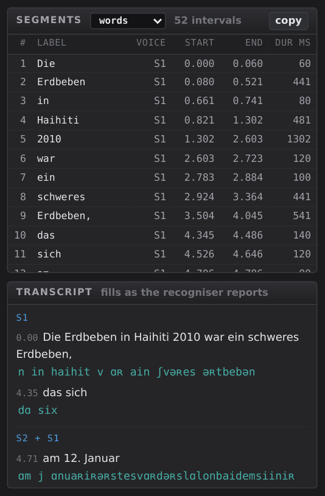

# Lana

**L**inguistic **ANA**lysis: Praat's acoustic analysis with word, phone and speaker tiers filled by speech recognition. Formerly *praat-web*. Lana is built on Praat but is not part of the Praat project or endorsed by its authors. The desktop version for macOS, Windows and Linux is built from the same repository; see the [top-level README](../README.md).

Phonetic analysis in the browser, with annotation tiers that can record what a speaker articulated rather than what a pronunciation dictionary predicts.

The analysis is Praat itself, compiled to WebAssembly. Pitch comes from `To Pitch`, formants from `To Formant (burg)`, and the spectrogram from `To Spectrogram`, with the same arguments and defaults you would type into the Praat script window. The audio is decoded and analysed inside your browser. Nothing is uploaded, and the tool makes no network request with your recording unless you explicitly send it to a transcription service you have configured.

```
python3 serve.py        # then open http://127.0.0.1:8710
```

Python 3.8 or later, standard library only. There is no build step, no `pip install`, and no Node. On first run the server downloads the `praat-wasm` package (about 24 MB) into `vendor/` and caches it.


A spoken German text about the 2010 Haiti earthquake, at 35.9 seconds. One model has filled both tiers in a single pass, German orthography above and IPA below, with each phone placed at the frame where the model committed to it. The cursor sits on the 160 ms /ɑ/ of *kamen*, and the row under the spectrogram reads that instant off the analysis: f0 204 Hz, F1 768 Hz, F2 1274 Hz, F3 2760 Hz, 77.9 dB. Every Praat argument that produced the picture is in the right-hand column, and the literal command line is printed beneath them.

## What you get with no backend at all

- A waveform of the visible window, with an overview strip for moving through the file, and a selection you can drag, play and zoom to.
- A spectrogram carrying **f0**, **F1**, **F2** and **F3**, with a frequency axis on the left and a separate f0 axis on the right.
- An **intensity** curve on its own decibel axis.
- A cursor readout of time, cursor frequency, f0, F1 to F3, intensity and the annotation label underneath.
- Word, phone and speaker tiers, and a **segment table** giving every interval a start, an end and a duration in milliseconds, exportable as TSV.
- Selection statistics: duration, its reciprocal in hertz as Praat reports it, mean f0 over the voiced frames, and how many intervals the selection covers.
- **TextGrid export**, including an empty grid spanning the file, which is how a hand annotation begins in Praat.
- Two colour schemes. **Graphite** is the default, and **Paper** puts the analysis on white so the screen shows what a figure will look like on the page. Both keep Praat's convention of dark for loud, because a phonetics tool should not invert the picture every textbook uses.

Analysis runs on the visible window only, as Praat's own editor does. The cost is roughly 270 ms per second of audio, so analysing an hour-long interview in one pass would stall the tab.

## The arguments are on screen, because they are the analysis

Every argument that shapes the analysis is an editable field, and underneath them the page prints the literal command line it will run:

```
Extract part... 0.000 6.540 rectangular 1 no
To Spectrogram... 0.005 5000 0.002 20 Gaussian
To Pitch... 0 75 600
To Formant (burg)... 0 5 5500 0.025 50
To Intensity... 75 0 yes
```

The defaults are Praat's own. Exposing them is not a convenience feature. A spectrogram is not one picture of a signal but a family of them, and which member you are looking at decides what can be claimed from it. A 5 ms window resolves the glottal striations that tell you about voicing and hides the harmonics, while a 30 ms window does the reverse. A formant ceiling set for a male speaker will merge F1 and F2 for a child. Reporting a measurement without the setting that produced it is reporting half of it, and the block above is written so it can be pasted into a Praat script and produce the same objects from the same file.

One rule governs the display. Nothing is ever drawn on an axis it does not belong to. Zooming while a re-analysis is pending leaves the previous spectrogram dimmed and sitting under the stretch of time it actually describes, with the analysed interval named in the corner, rather than stretched across the new window. A stale picture is tolerable. A mislabelled one is not.

## Why the tiers are not forced alignment

Conventional forced alignment begins with orthography. An aligner such as the Montreal Forced Aligner takes a transcript, looks each word up in a pronunciation dictionary, and fits the resulting phone string to the signal. The labels therefore originate in the lexicon rather than in the recording. The more capable systems soften this: MAUS builds a graph of pronunciation variants from rules and selects among them, so it can prefer a reduced realisation over a citation form. Even then the candidate set is derived from the lexicon and the rules, which means the aligner chooses among the realisations it was told to expect. A variant nobody encoded cannot be selected, and the segments where that matters are exactly the ones a phonetician is likely to be studying.

Lana is built around a different source of labels. Its tier contract expects a recogniser that reads phones off the acoustics and emits IPA directly, with no lexicon in the path. Models of this kind, such as PhoneticXeus or the wav2vec2 IPA models fine-tuned on Buckeye, produce a symbol because the frames supported it. When a speaker reduces *going to* to something closer to [ɡʌnə], a dictionary-driven aligner records the canonical sequence and distributes it across the interval, while a phone recogniser records the reduction. The distinction is not cosmetic. It determines whether your annotation can be evidence about variation or merely a restatement of the transcript.

Pairing the two kinds of model on one timeline is what the interface is for. You assign a model to the word tier and a model to the phone tier, and they are run in that order against the same recording. The two tiers are then independent observations of the same signal. Where they diverge, the divergence is itself the finding: the word tier preserves the lexical item a listener would report, while the phone tier preserves the realisation. A researcher studying lenition, connected-speech processes or sociophonetic variation wants both, aligned, and wants to see them under a spectrogram rather than in a table.

Assigning one model to both tiers is the other useful case. A model such as `ipa` runs a speech recogniser and a phone recogniser over the same segments, so it fills both tiers from one pass and is uploaded once rather than twice. The interface says which arrangement it is about to use before anything is sent.

The second thing this arrangement allows is work on languages that have no pronunciation dictionary at all. Forced alignment is unavailable, in practice, wherever a lexicon has not been built, which excludes most of the world's languages and nearly all of the ones that documentation projects are concerned with. Orthographic models such as MMS cover over a thousand languages, and multilingual phone recognisers generalise across inventories precisely because they never consult a lexicon. For Avar, Chechen or Dargwa there is no aligner dictionary to fall back on, yet a phone recogniser will still return IPA with frame-level timing. The tier contract below is deliberately model-agnostic so that this route remains open.


Georgian makes the argument visible. The word tier here is MMS-1b-all with its `kat` adapter, the phone tier is PhoneticXeus, and the cursor sits on the /i/ of ანტარქტიკის. The segment table gives that word as ɑ n tʼ ɑ r kʼ tʼ i kʼ i s, with ejectives where the orthography has ტ and ქ, and each interval timed to the millisecond.

Now read the transcript panel at the bottom right. The speech recogniser inside `ipa` is Whisper, which has almost no Georgian, and it returned a run of Mkhedruli letters that is not what the speaker said. The IPA directly beneath it is right anyway. Nothing that produced those symbols consulted a lexicon or a transcript, so the failure of the one did not propagate into the other. What did propagate is the spacing: the word divisions in that IPA line are wrong, because word intervals come from the transcript and the transcript was wrong. That is the reason the word tier in this figure was assigned to a different model, and the reason the two tiers are worth keeping separate. Audio from [FLEURS](https://huggingface.co/datasets/google/fleurs) `ka_ge`, CC-BY-4.0.

## What the phone timings actually are, and what they are not

The timings deserve a precise statement, because their usefulness depends on what they measure.

A CTC phone recogniser produces a distribution over its symbol inventory for every frame, typically one frame per 20 ms. Decoding yields a symbol together with the frame at which the model committed to it. `phone_times` in the contract below carries those frame times, so each phone label is timed from the model's own reading of that token rather than interpolated across a word interval. This is the sense in which the boundaries follow the articulation. They derive from the acoustics of the instance in front of you rather than from a template stretched to fit.

They are not, however, measurement-grade segment boundaries, and reporting them as such would misrepresent them. CTC output is peaky: the model tends to commit to a label at one frame near the middle of the evidence for it and to emit blanks elsewhere, so a spike marks the region of a segment rather than its onset. Frame resolution puts a floor of roughly 20 ms under any boundary. Treating consecutive spikes as a segment's start and end, which is what this viewer draws, therefore gives a good approximation of where a phone lies and a poor estimate of how long it lasted.

The practical consequence shapes how the tool is meant to be used. Machine phone labels are a first pass that you verify against the spectrogram, and the viewer exists to put them where that verification is cheap. For locating tokens, counting them, or cutting a corpus into candidates for closer study, spike times are sufficient. For duration measurements, VOT, or anything else where a few tens of milliseconds carry the argument, correct the boundaries by hand in Praat, which is why the export is a TextGrid rather than a proprietary format.

Two further limits are worth stating plainly. A phone recogniser has its own error rate and its own inventory, so a symbol absent from the inventory cannot appear no matter how clearly it was articulated. PhoneticXeus, for instance, returned no tone marks on Vietnamese in testing, which is worth verifying before relying on it for any tonal language. Word intervals, meanwhile, come from a separate forced aligner in most pipelines, so the word tier inherits that aligner's assumptions even when the phone tier does not.

## Watching the annotation arrive

A transcription is not an event but an interval. Whisper yields its segments lazily and the phone pass runs per segment, so on a long recording there is finished, correct annotation minutes before the request returns. Waiting for the response to draw any of it throws that away, and it also leaves the person in front of the screen unable to tell a working job from a hung one.

So the page draws each tier the moment its model reports, and says what is happening to the other one. A lane that has no annotation yet because its model is still reading the signal is drawn with moving diagonals and the name of the model. A lane whose model has not started is drawn the same way in a different colour and says it is queued. A lane with nothing coming says that instead. The difference between an empty tier and an unfinished one is the difference between a result and a wait, and the two should never look alike.



The same 113 second recording, part way through. `whisper` has returned and its intervals are drawn, so the transcript is readable and exportable already. `ipa` is still reading the signal, and its lane says which model is working instead of sitting empty. The bar under the toolbar is the recogniser's own reported progress, not an animation standing in for one.

This needs a recogniser that serves `progress` and `partial`, described below. One that serves neither still works, and its tiers fill when the response arrives, which is what would happen anyway.

The same machinery survives a reload. The page asks the recogniser what it is doing, adopts a job it did not start, and works out from the content of the cues which tier that job can fill. A reload during a long run therefore shows the progress and the annotation so far, rather than an inviting Run button whose only possible outcome is a refusal.

It asks late, and deliberately. On a gateway that swaps models through one GPU, requesting the recogniser's progress is enough to make the gateway start the recogniser, which unloads whatever else was holding the card. Opening a spectrogram would then evict a colleague's language model before any audio had been chosen. The question is therefore held back until audio is loaded and a tier has a model assigned, which together mean recognition is actually intended. Nothing is lost by waiting, because a browser cannot keep a file across a reload either.

## Who is speaking, and why it does not wait its turn

A third tier answers a different question from the other two. Word and phone tiers record what was said. A speaker tier records who said it, and it needs neither a language code nor a transcription in order to do so, because a speaker embedding keys on the voice rather than on the words. That independence is not a detail of the implementation. It is what allows the tier to be added without slowing anything else down.

The diarizer runs pyannote's segmentation model and a speaker embedding through onnxruntime, on the processor, and allocates no video memory at all. A recogniser on a single card has to wait for whatever else holds that card, and on the machine this was built for a gateway enforces exactly one tenant. The diarizer sits outside that arrangement, so it starts at the same moment the recogniser does and is usually finished while the transcription is still running. Measured on eight cores, ten minutes of audio costs about forty five seconds.

Two arguments sit beside the model, and between them they are the analysis. The count fixes how many speakers to find. Leaving it blank hands that decision to a clustering threshold instead, and the threshold is not a default to be left alone. On one ten minute recording it returned sixteen speakers at 0.5 and two at 1.1, from identical audio and an identical model. A tool that hid that number behind a reasonable-looking default would be presenting a guess as a measurement. Both fields are editable for the same reason every Praat argument on the right of the screen is editable.


Two German speakers, spliced into alternating six second blocks so that the right answer is known before the model runs. The window straddles the first change of voice, which the splice puts at exactly six seconds. The tier closes S1 at 6.04 and opens S2 at 6.44, leaving the silence between them attributed to nobody, which is the correct thing to do with it. The same pass has filled the word and phone tiers above it, and the cursor readout names the voice along with the labels: S2, the /ɑ/ of *Januar*, f0 113 Hz, F1 489 Hz, F2 1283 Hz, 66.1 dB. The speaker count and the clustering threshold sit beside the model, and **re-cluster** changes the number of voices without reading the audio again.

The result exports as an ordinary interval tier named `speakers`, labelled S1, S2 and so on in the order the voices first appear, which is the convention Praat, ELAN and CLAN share. It is written only when it has intervals, so a TextGrid from a recording nobody diarized keeps exactly the shape it had before this tier existed.

One limit is worth stating plainly. The segmentation model detects overlapping speech and the clustering step then discards it, because a TextGrid tier cannot hold two intervals at the same time. Where two people talk over each other, the tier names one of them.

### Attaching the voices to the words

A speaker tier on its own says when the voices change. What a transcript needs is who said each word, and that join happens in the page rather than in either service. The two tiers come from different models that run at the same time and finish in either order, neither can see the other's output, and doing the join once at the end would produce a transcript that gains its speakers only when the diarizer happens to finish last.

Overlap is tallied per speaker rather than per turn. A cue running S1, S2, S1 gives S1 two separate overlaps, and choosing the single largest turn would hand that cue to S2 on a tie. What comes out is a voice on every word, a transcript grouped by turn, a voice column in the segment table, and the speaker named in the cursor readout.

A span covering more than one voice is reported as covering more than one voice. This is not a rare case. A recogniser that returns cue-level intervals rather than word timings can easily produce a sixteen second cue containing two people, and attributing all of it to whoever held it longest would be a summary presented as a measurement. Such a span reads `S1 + S2` in the transcript and `S1+` in the table. Word timings make the question go away, because a word is short enough to belong to one voice.



The same recording, in the two panels where the join shows. Every word carries the voice that said most of it, and the transcript is broken into turns. The heading `S2 + S1` is not a hedge but a reading: that cue begins before the change of voice and ends after it, so it really does contain two people.

The exports carry it. The TSV gains a speaker column, SRT puts the name in the line, and WebVTT uses `<v S1>`, a cue voice span that players and the WebVTT DOM read as an attribution rather than as part of the text. WebVTT is the one subtitle format with a speaker of its own, which is why it is here.

### Changing the number of voices without reading the audio again

The count is the argument worth iterating on, and a full pass costs forty seconds. So the service keeps the recording from the last job against a hash, and the **re-cluster** button re-partitions the turns it already found into a different number of voices. Measured on ten minutes of audio: nine seconds for the first re-cluster, which computes and then keeps the embeddings, and about two tenths of a second for every one after it, against forty three for a full pass.

It takes a count and never a threshold. The re-clustering is the service's own average linkage rather than the one inside sherpa-onnx, so the same threshold number would mean two different things depending on which route produced it. A count means the same thing either way.

One cost of this is visible in the interface. A turn whose windows all agree keeps the segmentation model's own boundaries. A turn that genuinely has to be split gains a boundary at window resolution, which is one second rather than the model's own, and the tier says so whenever it happens. Running the model again gives the precise boundaries back.

## Getting the annotation out

Subtitles come out as SRT, ASS or WebVTT, and WebVTT is the one to pick when the recording has been diarized, because `<v S1>` attributes a cue to a voice rather than writing the name into the line. The rest of this section is about the TextGrid, which is the export that matters for annotation work.

The export is a TextGrid because that is the format both major annotation tools read. Praat opens it directly. ELAN imports it through File > Import > Praat TextGrid File, adding each tier to the open document or creating a new one, and it accepts UTF-8 as well as UTF-16, so the encoding written here needs no conversion.

That choice matters more for documentation work than for laboratory phonetics. Fieldwork projects generally keep their sessions in ELAN, where phonetic tiers sit on one timeline alongside translation, gloss and gesture tiers. Exporting a TextGrid lets a recogniser's phone tier enter an existing ELAN session, rather than starting a parallel annotation that somebody has to reconcile later. For the undocumented languages discussed above, that is usually the deciding practical question, because the session already exists in ELAN before any acoustic analysis begins.

One point about the import itself. Praat requires the intervals of a tier to tile the file without gaps, so this tool writes an empty interval wherever no word or phone falls. ELAN's import dialog offers "Skip empty intervals / annotations", and leaving that checked keeps the padding out of the ELAN document, where it would otherwise arrive as a run of empty annotations.

## Connecting a recogniser

There are two ways to reach one, and the tool does not prefer either.

**Direct.** Type the base URL of an endpoint under **⚙ Connection** and the browser posts to it. Nothing to install. The endpoint has to send `Access-Control-Allow-Origin`, and any key you gave it would be visible in the page, so this mode suits a recogniser running on your own machine or network.

**Proxied.** Copy `providers.example.json` to `providers.json` beside `serve.py` and list the services you use. The page then asks its own server for the list and posts through it:

```json
{
  "providers": [
    { "id": "local", "label": "llama-swap", "kind": "openai",
      "base": "http://127.0.0.1:9292", "control": "/upstream/asr",
      "models": [ { "id": "ipa", "role": "both" },
                  { "id": "whisper", "role": "words" },
                  { "id": "diarize", "role": "speakers" } ] },

    { "id": "openai", "label": "OpenAI", "kind": "openai",
      "base": "https://api.openai.com", "api_key_env": "OPENAI_API_KEY",
      "fields": { "timestamp_granularities[]": "word" },
      "models": [ { "id": "whisper-1", "role": "words" } ] }
  ]
}
```

This mode exists for three reasons, and only the first is about secrecy. An API key stays on the machine running `serve.py`, which is told to read it from the environment and never sends it to the browser. Every request is same-origin, so there is no CORS to configure, which is what makes the tool usable by a colleague who did not set the recogniser up. And providers disagree about where word timings live, so the server normalises the reply and the page parses one contract instead of five.

`role` says which tier a model can fill before it has run, so the queue can tell you what is coming. It takes `words`, `phones`, `both` or `speakers`. The reply is believed over the hint, except for `speakers`, which also decides that the model runs alongside the others rather than behind them.

A word of warning about the proxy. There is no authentication in `serve.py`. Anyone who can open the page can spend the keys behind it, so bind it to `127.0.0.1`, which is the default, or put it behind something that asks who is knocking. The server prints a warning if you bind it to a reachable address with keys configured.

`kind: "openai"` means the provider implements `POST {base}/v1/audio/transcriptions` in the OpenAI shape. That covers OpenAI itself, Groq, Fireworks, Together, llama-swap, faster-whisper-server and most local wrappers. Another API shape needs a function in `serve.py`, next to `normalise()`, which is the extension point.

## The tier contract

The request is `multipart/form-data` carrying `file`, `model`, `response_format=verbose_json`, an optional `language`, and an optional `asr_model`. To draw tiers, the response needs timed words:

```jsonc
{
  "text": "...",
  "language": "en",
  "cues": [{
    "start": 1.12, "end": 2.48,
    "words": [{
      "text": "when",
      "start": 1.12, "end": 1.26,
      "phones": ["w", "ɛ̃", "n"],          // optional: fills the phone tier
      "phone_times": [1.12, 1.17, 1.22]   // optional: per-phone frame times
    }]
  }]
}
```

`cues[].words[]` with `start` and `end` fills the word tier. Adding `phones` produces a phone tier as well. Adding `phone_times` is what distinguishes this from an even division of the word. Without it the viewer spaces the symbols evenly across the interval, which is a display convenience and carries no information about the recording. A response with cues but no words still draws one interval per cue, and says on the tier that the model timed segments rather than words.

A cue carrying `speaker` and no words fills the speaker tier and nothing else:

```jsonc
{
  "speakers": 2,
  "cues": [{ "start": 0.03, "end": 6.04, "speaker": 0 },
           { "start": 6.44, "end": 12.37, "speaker": 1 }]
}
```

Such a reply must not carry `text` or `plain`, or a client routing cues by their content will read the turns as a transcription and overwrite a real one. Speaker numbers are zero based and are renumbered by order of first appearance before they are drawn. A diarization request carries `speakers`, `threshold`, `min_on` and `min_off` in place of `language`, and `role: "speakers"` in `providers.json` is what tells the interface that a model answers this way.

An OpenAI-shaped reply needs no translation. The proxy maps `segments` to cues and puts the flat `words` list back into the segment each word falls in, which is why `timestamp_granularities[]=word` is worth asking for.

Three optional endpoints are used if present and ignored if not.

| endpoint | gives you |
| --- | --- |
| `GET {control}/progress` | `{active, model, stage, done, total, elapsed, job, cues_ready}` for the progress bar |
| `GET {control}/partial?since=N` | `{job, cues, since, total, complete}`, the cues finished so far |
| `POST {control}/cancel` | a Stop button that actually stops the job |
| `POST {control}/recluster` | `{hash, speakers}` re-partitions a cached diarization without re-reading the audio |

A model may carry its own `control` in `providers.json`, overriding the provider's. On a gateway that swaps models, each service sits behind its own path, so the diarizer's progress and re-clustering do not live where the recogniser's do. A diarization reply that carries a `hash` is what enables the re-cluster button, and a service that returns none simply does not offer one.

`cues_ready` on the progress reply is the count of cues available, and `partial` returns those after index `N` in the same shape as the final response. `job` rises once per job, so a client that sees it change knows its accumulated cues belong to a previous run. These three are what turn the tiers from a result into a display that fills while you watch, and a recogniser that omits them still works.

## Notes that cost someone a day

- **Praat writes TextGrids in UTF-16.** This project emits UTF-8 directly, which Praat reads without complaint.
- **Praat rejects an entire TextGrid over a single inverted interval** (`Wrong xmin ... and xmax ...`). Phone spike times are absolute and can fall a few milliseconds past the end of the word they were assigned to, so intervals are forced sorted, non-overlapping and strictly increasing before export.
- **Intensity has no `To Matrix`, but it does have `Down to Matrix`.** Spectrogram, Pitch and Formant all export through `To Matrix`, and trying the same name on an Intensity object fails, which reads as "no bulk export exists" and is wrong. Matrix export is the only usable way out of the wasm in any case, because the per-point getters echo to the Praat Info window and become unusable in bulk.
- **Formant dots appear during silence.** That is the Burg algorithm, which always returns a solution, rather than a fault in the tracker. Praat behaves identically.
- Audio is re-encoded to 16 kHz mono WAV in the browser before Praat receives it. Praat's `readAudio` accepts WAV, AIFF, FLAC, MP3 and OGG, while the browser's own decoder also handles m4a, mp4 and webm, so re-encoding means anything your browser can play can be analysed.
- A `File` object cannot survive a page reload, so re-select the audio after one. The annotation is adopted back from the recogniser, but the audio has to come from you.
- **A proxy that whitelists form fields silently drops the ones you add later.** `serve.py` forwards a named list of extra fields and ignores the rest, which is right for a broker that also talks to OpenAI. The failure it produces, though, is a model quietly ignoring an argument you can see on screen, which reads as a broken model rather than a dropped field. New arguments have to be added to that list.
- **Clustering windows of unequal length clusters the lengths.** Re-clustering embeds fixed windows across the speech the first pass found, and the short remainder window at the end of each turn embedded more like the other short windows than like its own speaker. The first split came out as "short windows versus long windows", which put a spurious change of voice in the last second of every turn in a two-speaker file. The final window of a turn is now pushed flush against its end so that it is full length, and windows below 1.2 seconds are attached to the nearest cluster afterwards rather than clustered.
- **The diarizer honours a cancel only at the end of its current pass.** sherpa-onnx accepts a return value from the progress callback and does not act on it, so a cancel at 14 seconds still ran the full 41. The page drops the connection as well, and the service releases its lock either way.
- **A server that has no handler for a POST answers 501, not 404.** The check for "there is no recogniser here" has to cover 404, 405 and 501, or a perfectly clear misconfiguration arrives as an unexplained failure.

## Credits and licence

The analysis is [**Praat**](https://www.fon.hum.uva.nl/praat/) by Paul Boersma and David Weenink, via [**praat-wasm**](https://www.npmjs.com/package/praat-wasm) (6.4.6200) by reynoldsnlp. This project supplies an interface and an alignment contract. The phonetics is theirs.

If Praat contributed to published work, cite it as its authors ask:

> Boersma, Paul & Weenink, David. *Praat: doing phonetics by computer* [Computer program]. http://www.praat.org/

The German recording in the figures is a listening-comprehension text published by MFL Sunderland, and it is not distributed here. The Georgian recording is from Google's [FLEURS](https://huggingface.co/datasets/google/fleurs) corpus, CC-BY-4.0.

The demo (`index.html?demo`) opens two readings of FLEURS sentence 1618, one Georgian and one German, from the dev split, converted to 16-bit WAV, CC-BY-4.0 (Conneau et al. 2022). Its recognition results were recorded from the models named in `demo/manifest.json`, Whisper at both medium and large-v3, and are replayed, while Praat's analysis runs live. `demo/record.py` regenerates them against a running `serve.py`.

Praat and praat-wasm are GPL-3.0-or-later, and so is this project. See [LICENSE](LICENSE). `vendor/` is not committed. Either let `serve.py` fetch it, or run `npm pack praat-wasm@6.4.6200 && tar xzf praat-wasm-6.4.6200.tgz && mv package vendor`.
